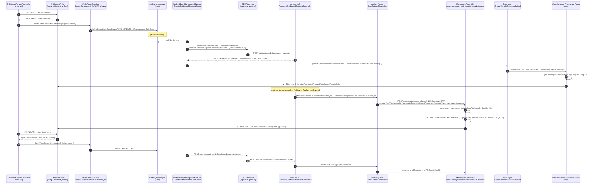

# Đặc tả kỹ thuật POC: FO Orchestrator, nhánh Inventory, Warehouse

> Ngày: 2026-10-20 · Loại: **POC**, chưa qua SA thẩm định, không đưa lên production
> Đọc trước: [thiet-ke-fo-orchestrator.md](thiet-ke-fo-orchestrator.md), [khao-sat-hien-trang.md](khao-sat-hien-trang.md)
> Repo sửa: **chỉ `oms-api`**, nhánh nền `feat/oms-wms-direct`. `wms-api-v2` và `pim-trading-api` **không sửa**.

---

## 0. Hướng dẫn cho agent thi công (Claude Code)

1. Đọc `oms-api/CLAUDE.md`, `oms-api/dotnet-cmd.md` và file này **trước khi code**. Code phải theo đúng pattern có sẵn của repo: MediatR, entity, DbUp, đăng ký DI, cách viết inbox handler.
2. **Không chạy lệnh git** (commit, push, tạo nhánh). Chỉ sửa working tree.
3. Schema DB chỉ đổi bằng **SQL viết tay** trong `database-migration/Scripts/janbox_user_management/oms/Schema/`. Không dùng `dotnet ef migrations`.
4. Integration test: chỉ chạy các class mình thêm, dùng `--filter`. Không chạy cả suite.
5. Không đổi hành vi của luồng cũ khi workspace **không** bật POC. Đây là tiêu chí nghiệm thu bắt buộc (§9).
6. Gặp chỗ đặc tả không khớp với code thật thì **dừng và báo lại**, kèm `file:line`. Không tự đoán.

---

## 1. Mục tiêu POC

Chứng minh trong `oms-api` có thể có **một orchestrator trung tâm (FO)** với các khả năng sau:

| # | FO làm được |
|---|---|
| G1 | Giữ trạng thái fulfillment của một SO trong bảng riêng (`fulfillment_orders`), API đọc ra được |
| G2 | **Tự phát lệnh** C4 tạo Outbound Request sang WMS, bằng đường outbox đã có |
| G3 | Nhận trạng thái từ WMS (E2) qua inbox đã có, cập nhật đúng thứ tự, không xử lý trùng |
| G4 | Hủy theo giai đoạn (C2): chưa qua Picking thì gửi lệnh hủy sang WMS; từ Packed trở đi thì trả **409** |
| G5 | Phát hiện kẹt: quá thời hạn mà WMS chưa phản hồi thì chuyển `REQUIRES_INTERVENTION` |
| G6 | Chạy song song với luồng cũ mà không tạo OR trùng: nếu luồng cũ đã gửi OR thì FO **nhận lại** OR đó thay vì gửi thêm |

## 2. Ngoài phạm vi

- Nhánh Dropship, Self pick & pack, POD. Gom hàng, lô, phí lưu kho.
- Mọi thay đổi ở `wms-api-v2`. WMS vẫn trả 200 kèm lỗi khi thiếu tồn; POC đọc lỗi đó từ event, xem §5.3.
- Đổi `SaleOrderStatusEnum` hay event SO. Luồng cũ vẫn tự cập nhật SO như hiện nay.
- Hủy theo dòng, refund, UI Seller Center (POC chỉ cần API).
- Contract cho Janbox (`/partner/janbox/...`). POC dùng endpoint nội bộ.

---

## 3. Bối cảnh code (đã khảo sát)

| Điểm | Vị trí |
|---|---|
| Gửi lệnh tạo OR (C4) | `ISaleOrderService.CreateOutboundOrderToWmsAsync(orderId, ct)`, cài ở `Ichiba.OMS.Infrastructure/Repositories/SaleOrderRepository.WmsIntegration.cs:90`. Hàm này gọi `wmsDispatcher.SendAsync(WmsCommandTypes.CreateOutboundRequest, …, aggregateType: "SaleOrder", aggregateId: orderId)` ở khoảng dòng 465, rồi ghi `outbox_messages` |
| Gửi lệnh hủy OR (C5) | `ISaleOrderService.SendWmsCancelOrder(orderId, reason, ct)` ở `SaleOrderRepository.WmsIntegration.cs:28` |
| Các chỗ luồng cũ tự gửi OR | Khoảng 10 call site, ví dụ `API/Consumers/SaleOrders/SalesOrderStatusUpdatedInternalEventHandler.cs:258`, `API/Controllers/PartnerApis/SaleOrderController.cs:160`, `API/Controllers/v1/SaleOrder/SalesOrderController.cs:560`, `API/Actors/IntegrationSaleChannel/ScOrderActor.cs:528,1068`. **POC không sửa các chỗ này** (xem G6) |
| Nhận event OR từ WMS (E2) | `Ichiba.OMS.Infrastructure/Messaging/Inbox/Outbound/OutboundStatusInboxHandlerBase.cs`. Handler chạy **trong transaction** của inbox. Sau `UpdateSaleOrderWmsStatusCommand` đã có `model.OrderId` (SO) |
| Một handler cho mỗi loại event | `OutboundInboxHandlers.cs` (`OutboundNewInboxHandler`, `…Allocated…`, `…Packed…`), dùng enum `IChiba.Wms.MessageContracts.OutboundMessageType` |
| Envelope inbox | `Ichiba.OMS.Application/Wms/Inbox/WmsInboxEnvelope.cs`: `Id`, `WorkspaceId`, `MerchantId`, `AggregateId`, `AggregateSequence` |
| Cron job | `Ichiba.OMS.API/CronJob/*` (ví dụ `InventoryLedgerReconcileCronJob.cs`) |
| Mẫu migration Citus | `schema0001689-add-messaging-inbox-outbox.sql`: PK `(id, workspace_id)` và `create_distributed_table(..., 'workspace_id')` |
| Entity base | `Ichiba.OMS.Domain/OmsEntityBase.cs` (`OmsEntityBase` có tenancy) |
| Liên kết OR ↔ SO | `Packages.WmsOrderId`. Một OR thuộc một package, một SO có thể có nhiều package |

> ⚠️ **Hệ quả của dòng cuối:** OR gắn với package, không gắn với SO. Một SO nhiều package sẽ sinh nhiều OR. POC theo dõi **từng OR** trong `fulfillment_order_refs`, và trạng thái FO được **tổng hợp** từ các OR (§5.2).

---

## 3a. Luồng gọi WMS từ đầu đến cuối

POC **không viết client WMS mới**. FO chỉ đi qua đường OMS ↔ WMS đã chạy trên `feat/oms-wms-direct`. Mục này mô tả đường đó để agent biết FO cắm vào đâu.

### 3a.1 Sơ đồ



### 3a.2 Bảng tra từng chặng

| # | Chặng | Code thật | Ghi chú cho POC |
|---|---|---|---|
| 1 | Ghi lệnh tạo OR vào outbox | `SaleOrderRepository.WmsIntegration.cs:90` (`CreateOutboundOrderToWmsAsync`) → `wmsDispatcher.SendAsync(WmsCommandTypes.CreateOutboundRequest, …)` ở khoảng dòng 465 | Hàm tự `SaveChangesAsync` ở giữa (khoảng dòng 450), xem cảnh báo ở §6.2. Chỉ đi đường direct khi provider là EFEX (`WmsDispatcher.ShouldUseDirectPathAsync`), các provider khác vẫn đi IL |
| 2 | Relay outbox | `Ichiba.OMS.Infrastructure/Messaging/OutboxRelayBackgroundService.cs`, cấu hình `Outbox:*` trong `appsettings.json` (poll 5s, tối đa 100 lần thử) | Không sửa |
| 3 | Gọi HTTP sang WMS | `Messaging/Senders/CreateOutboundRequestSender.cs:48` → `IWmsOutboundRequestConnector.CreateWmsOrderAsync` → `EFEXV2Constants.Order.OutboundRequest` = `operator-partner/{v}/outbound-requests`, base URL `BFF_Operator:BaseUrl` (`Connectors/Ichiba.OMS.WmsConnector.EFEXV2/ConfigureServices.cs:38`) | Sender dịch `ProductVariantId` sang id WMS qua `wms_product_mappings`. Thiếu mapping thì không gọi WMS và báo lỗi `PRODUCTS_DOES_NOT_EXIST_IN_FBE_WAREHOUSE` |
| 4 | WMS nhận lệnh | BFF rewrite sang `wms-api-v2` `Api/Controllers/Partners/OutboundRequestController.cs:20` (`POST api/partner/v1/outbound-requests`) → `CreateOutboundRequestCommand` / `ProcessOutboundRequestCommand` (tạo OR và trừ tồn trong cùng transaction) | Thiếu tồn: WMS trả **200 kèm lỗi theo từng package**, không phải 409 |
| 5 | Kết quả đồng bộ quay về OMS (**ack của C4**) | Sender `PublishResultAsync` (khoảng dòng 396) publish Dapr `CreateWmsOrSuccessModel` hoặc `CreateWmsOrFailedModel`, mỗi package một message → `Ichiba.OMS.API/Consumers/WmsIntegrations/WmsOutboundConsumer.Create.cs` (`CreateWmsOrSuccessConsumer`, `CreateWmsOrFailConsumer`:48) | **Điểm cắm 1.** Tại đây FO biết `WmsOrderId` của từng package, hoặc biết lệnh lỗi kèm mã lỗi (thiếu tồn, thiếu mapping, không tìm thấy merchant) |
| 6 | WMS phát trạng thái OR | `wms-api-v2` `Infrastructure/Implements/MerchantService.cs:266` (`PublishOutboundAsync`) → `OmsEventDispatcher.TryDispatchToOmsAsync` → outbox WMS → `Infrastructure/Messaging/Dispatchers/OmsOutboxDispatcher.cs` → `Connectors/Ichiba.Wms.OmsConnector/Services/OmsInboxClient.cs:56` POST `/oms-partner/internal/wms/{v}/inbox` | Không sửa WMS |
| 7 | OMS nhận trạng thái OR (**E2**) | `Ichiba.OMS.API/Controllers/InternalConnector/WmsInboxController.cs` → `ProcessWmsInboxCommand` → handler theo `(AggregateType=OutboundRequest, MessageType)` trong `Messaging/Inbox/Outbound/OutboundInboxHandlers.cs` → `OutboundStatusInboxHandlerBase.HandleAsync` | **Điểm cắm 2.** Chạy trong transaction của inbox. Event `New` bị connector bỏ qua, nên event đầu tiên FO nhận được thường là `Allocated` |
| 8 | Lệnh hủy OR (C5) | `SaleOrderRepository.WmsIntegration.cs:28` (`SendWmsCancelOrder`) → `WMS_CANCEL_OR` → `CancelOutboundRequestSender` → `operator-partner/{v}/outbound-requests/cancel` → WMS `Partners/OutboundRequestController.cs:65` | WMS hủy được ở New/Allocated/ToPick. Từ Picking trở đi WMS chỉ đặt cờ `PartnerCancel`, nên FO chặn hủy từ `WH_PACKED` (§5.3) |

### 3a.3 Hệ quả cho thiết kế FO

- **Có hai điểm cắm vào luồng cũ, không phải một:** consumer kết quả tạo OR (chặng 5) và inbox trạng thái OR (chặng 7). Ngoài hai điểm này, FO không sửa gì khác trong luồng cũ.
- **Ack của C4 là chặng 5, không phải chặng 7.** Timeout `AckTimeoutMinutes` được xoá khi nhận `OutboundCreated`, tức là sớm hơn event `Allocated`.
- **Thiếu tồn được biết ngay ở chặng 5**, qua `CreateWmsOrFailedModel.ErrorCode`, không cần chờ timeout.
- **Chặng 5 chạy qua Dapr, không có `AggregateSequence`.** Tín hiệu `OutboundCreated` được xử lý idempotent theo `(fo, wmsOrderId)`: ref đã có thì bỏ qua.

---

## 4. Mô hình dữ liệu

### 4.1 Migration

Tạo file `database-migration/Scripts/janbox_user_management/oms/Schema/schema00179-add-fulfillment-orders.sql`. Kiểm số thứ tự cuối cùng trong thư mục trước khi đặt tên; hiện bản mới nhất là `schema00178`. Header comment theo đúng mẫu `schema0001689`.

```sql
SET search_path = oms;

CREATE TABLE IF NOT EXISTS oms.fulfillment_orders (
    id                   uuid         NOT NULL,
    workspace_id         uuid         NOT NULL,
    sale_order_id        uuid         NOT NULL,
    place_idem_key       varchar(100) NOT NULL,
    ffm_order_type       int          NOT NULL,      -- 1 DROPSHIP, 2 INVENTORY, 3 POD
    fulfillment_mode     int          NOT NULL,      -- 1 WAREHOUSE, 2 SELF_PICKPACK
    status               int          NOT NULL,      -- FulfillmentOrderStatus
    status_reason        varchar(500) NULL,
    timeout_at           timestamp    NULL,          -- mốc giám sát gần nhất, NULL = không theo dõi
    version              int          NOT NULL DEFAULT 0,
    completed_at         timestamp    NULL,
    cancelled_at         timestamp    NULL,
    created_at           timestamp    NOT NULL,
    created_by           text         NOT NULL,
    updated_at           timestamp    NULL,
    updated_by           text         NULL,
    is_deleted           boolean      NULL DEFAULT false,
    deleted_at           timestamp    NULL,
    deleted_by           text         NULL,
    CONSTRAINT pk_fulfillment_orders PRIMARY KEY (id, workspace_id)
);
SELECT create_distributed_table('oms.fulfillment_orders', 'workspace_id');
CREATE UNIQUE INDEX IF NOT EXISTS ux_fulfillment_orders_place_key
    ON oms.fulfillment_orders (workspace_id, place_idem_key);
CREATE UNIQUE INDEX IF NOT EXISTS ux_fulfillment_orders_sale_order
    ON oms.fulfillment_orders (workspace_id, sale_order_id);
CREATE INDEX IF NOT EXISTS ix_fulfillment_orders_timeout
    ON oms.fulfillment_orders (timeout_at) WHERE timeout_at IS NOT NULL;

CREATE TABLE IF NOT EXISTS oms.fulfillment_order_refs (
    id                   uuid         NOT NULL,
    workspace_id         uuid         NOT NULL,
    fulfillment_order_id uuid         NOT NULL,
    ref_type             int          NOT NULL,      -- 1 WMS_OUTBOUND (POC chỉ dùng loại này)
    ref_id               varchar(100) NOT NULL,      -- WMS OR id (= Packages.WmsOrderId)
    package_id           uuid         NULL,
    ref_status           int          NOT NULL,      -- trạng thái OR đã mirror (FulfillmentRefStatus)
    last_seq             bigint       NOT NULL DEFAULT 0,
    created_at           timestamp    NOT NULL,
    created_by           text         NOT NULL,
    updated_at           timestamp    NULL,
    updated_by           text         NULL,
    CONSTRAINT pk_fulfillment_order_refs PRIMARY KEY (id, workspace_id)
);
SELECT create_distributed_table('oms.fulfillment_order_refs', 'workspace_id',
                                colocate_with => 'oms.fulfillment_orders');
CREATE UNIQUE INDEX IF NOT EXISTS ux_fulfillment_order_refs_ref
    ON oms.fulfillment_order_refs (workspace_id, ref_type, ref_id);

CREATE TABLE IF NOT EXISTS oms.fulfillment_order_events (
    id                   uuid         NOT NULL,
    workspace_id         uuid         NOT NULL,
    fulfillment_order_id uuid         NOT NULL,
    signal               varchar(100) NOT NULL,      -- tên tín hiệu, ví dụ Placed, OutboundPacked, Timeout
    from_status          int          NOT NULL,
    to_status            int          NOT NULL,
    detail               jsonb        NULL,
    occurred_at          timestamp    NOT NULL,
    CONSTRAINT pk_fulfillment_order_events PRIMARY KEY (id, workspace_id)
);
SELECT create_distributed_table('oms.fulfillment_order_events', 'workspace_id',
                                colocate_with => 'oms.fulfillment_orders');
CREATE INDEX IF NOT EXISTS ix_fulfillment_order_events_fo
    ON oms.fulfillment_order_events (workspace_id, fulfillment_order_id, occurred_at);
```

> Đối chiếu với các bảng tenancy có sẵn (cột audit, soft delete) để đặt tên cột khớp với cách `EntityTenancyBase` map. Lệch thì chỉnh SQL theo entity base, không làm ngược lại.

### 4.2 Entity và enum

Đặt trong `Ichiba.OMS.Domain/Fulfillment/`:

- `FulfillmentOrder : OmsEntityBase`. Chứa trạng thái, `Version` (concurrency token) và **toàn bộ logic chuyển trạng thái** (§5).
- `FulfillmentOrderRef : OmsEntityBase`
- `FulfillmentOrderEvent`. Chỉ thêm (append-only), không soft delete.
- Các enum `FfmOrderType`, `FulfillmentMode`, `FulfillmentOrderStatus`, `FulfillmentRefStatus`, `FulfillmentRefType`.

Tên bảng khai báo trong `TableNameConstants`, theo cách các entity khác đang làm. Thêm `DbSet` vào `ApplicationDbContext` và interface tương ứng.

---

## 5. Máy trạng thái

### 5.1 Trạng thái FO trong POC

```
RECEIVED ──Place──► DELEGATED ──(mọi OR ≥ Allocated)──► WH_ALLOCATED
   │                   │                                   │
   │                   ├──Timeout──► REQUIRES_INTERVENTION  ▼
   │                   │                             WH_PICKING ──► WH_PACKED ──(mọi OR Shipped)──► COMPLETED
   │                   └──(có OR OutOfStock)──► WH_OUT_OF_STOCK
   │
   └── Cancel (cho phép tới WH_PICKING) ──► CANCEL_REQUESTED ──(mọi OR Cancelled)──► CANCELLED
```

| Giá trị | Tên | Ý nghĩa |
|---|---|---|
| 0 | `RECEIVED` | FO vừa tạo, chưa phát lệnh |
| 10 | `DELEGATED` | Đã có lệnh C4 trong outbox, hoặc đã nhận lại OR do luồng cũ tạo |
| 20 | `WH_ALLOCATED` | Mọi OR đã phân bổ tồn |
| 30 | `WH_PICKING` | Có ít nhất một OR đang pick hoặc pack |
| 40 | `WH_PACKED` | Mọi OR đã đóng gói xong |
| 50 | `WH_OUT_OF_STOCK` | Có OR báo thiếu tồn |
| 60 | `CANCEL_REQUESTED` | Đã gửi C5, chờ WMS xác nhận |
| 90 | `REQUIRES_INTERVENTION` | Hết hạn hoặc lỗi lệnh, cần người xử lý |
| 100 | `COMPLETED` | Mọi OR đã giao DVVC (`Shipped`) |
| 110 | `CANCELLED` | Đã hủy xong |

`COMPLETED` và `CANCELLED` là trạng thái cuối: mọi tín hiệu tới sau chỉ ghi log, không đổi trạng thái.

### 5.2 Tổng hợp từ các OR

Mỗi `FulfillmentOrderRef` giữ `ref_status` (`FulfillmentRefStatus`), ánh xạ từ `OutboundMessageType`:

| `OutboundMessageType` (WMS) | `FulfillmentRefStatus` | Thứ hạng |
|---|---|---|
| `New` | `Created` | 1 |
| `Allocated` | `Allocated` | 2 |
| `UnAllocated` | `Created` (cho phép lùi) | 1 |
| `ToPick`, `Picking`, `Picked`, `ToPack`, `Packing` | `InProgress` | 3 |
| `Packed`, `ToShip` | `Packed` | 4 |
| `Shipped` | `Shipped` | 5 |
| `OutOfStock` | `OutOfStock` | — |
| `Cancelled` | `Cancelled` | — |
| Các loại khác (`UpdateLastMile`, `UpdateForwarding`, `UpdateMedia`…) | Không đổi | — |

> Agent thi công phải mở enum `OutboundMessageType` thật trong package `IChiba.Wms.MessageContracts`, đối chiếu đủ mọi member, và ghi rõ trong code member nào cố ý bỏ qua.

Trạng thái FO là **hàm thuần** của tập `ref_status`, tính sau mỗi tín hiệu:

1. Đang ở trạng thái cuối thì giữ nguyên.
2. Đang `CANCEL_REQUESTED`: nếu mọi ref là `Cancelled` thì chuyển `CANCELLED`, ngược lại giữ nguyên.
3. Có ref `OutOfStock` thì `WH_OUT_OF_STOCK`.
4. Mọi ref `Cancelled` (WMS tự hủy) thì `CANCELLED`.
5. Mọi ref không bị hủy đều ở `Shipped` thì `COMPLETED`.
6. Mọi ref không bị hủy đều ≥ `Packed` thì `WH_PACKED`.
7. Có ref ≥ `InProgress` thì `WH_PICKING`.
8. Mọi ref ≥ `Allocated` thì `WH_ALLOCATED`.
9. Còn lại là `DELEGATED`.

`REQUIRES_INTERVENTION` không đến từ OR. Nếu sau đó có tín hiệu OR mới tới, áp lại các quy tắc trên, tức FO tự thoát trạng thái này.

### 5.3 Tín hiệu và hành động

Mỗi tín hiệu là một method của `FulfillmentOrder`, trả về danh sách **lệnh cần phát**. Entity không gọi service.

| Tín hiệu | Điều kiện | Đổi trạng thái | Lệnh phát |
|---|---|---|---|
| `Place` | FO mới tạo | `RECEIVED → DELEGATED`, đặt `timeout_at = now + AckTimeout` | `SendCreateOutbound` (trừ trường hợp nhận lại OR cũ, xem §6.2) |
| `OutboundCreated(packageId, wmsOrderId)` (chặng 5, §3a) | Ref `wmsOrderId` chưa có. Có rồi thì bỏ qua | Tạo ref `Created`, tính lại theo §5.2, xoá `timeout_at` | — |
| `OutboundCreateFailed(packageId, errorCode)` (chặng 5) | FO đang `DELEGATED` | `errorCode` chứa `OUT_OF_STOCK`/`INSUFFICIENT` thì `→ WH_OUT_OF_STOCK`. Mã khác (`PRODUCTS_DOES_NOT_EXIST_IN_FBE_WAREHOUSE`, `WMS_MERCHANT_NOT_FOUND`, `NOT_FOUND_PACKAGES`…) thì `→ REQUIRES_INTERVENTION`. Ghi `status_reason = errorCode`, xoá `timeout_at` | — |
| `OutboundStatus(refId, type, seq)` (chặng 7) | `seq > ref.last_seq`. Trùng hoặc cũ hơn thì bỏ qua và ghi log | Cập nhật ref (chưa có thì tạo) rồi tính lại theo §5.2. Có ref ≥ `Created` thì xoá `timeout_at` | — |
| `Cancel` | Trạng thái thuộc {`RECEIVED`, `DELEGATED`, `WH_ALLOCATED`, `WH_PICKING`, `WH_OUT_OF_STOCK`, `REQUIRES_INTERVENTION`} | `→ CANCEL_REQUESTED` (nếu chưa có ref nào thì `→ CANCELLED`) | `SendCancelOutbound` (chỉ khi đã có ref) |
| `Cancel` | `WH_PACKED` trở đi | Không đổi | Không phát lệnh. API trả **409** `fulfillment.cancel-not-allowed` |
| `Timeout` | `timeout_at <= now` và đang `DELEGATED` | `→ REQUIRES_INTERVENTION`, xoá `timeout_at` | — |

Mỗi lần đổi trạng thái ghi thêm một dòng `fulfillment_order_events`.

> Về "thiếu tồn": WMS trả 200 kèm lỗi theo từng package. Sender đổi lỗi đó thành `CreateWmsOrFailedModel`, và FO nhận được qua tín hiệu `OutboundCreateFailed` ở chặng 5. Agent phải ghi lại trong báo cáo POC **mã lỗi thật** mà WMS trả khi thiếu tồn, lấy từ `CreateOutboundRequestCommand.cs:130-135` phía WMS. Quy tắc "chứa `OUT_OF_STOCK`/`INSUFFICIENT`" ở trên chỉnh lại theo mã thật đó.

---

## 6. Luồng xử lý

### 6.1 Bật POC theo workspace

Thêm cấu hình `FulfillmentOrchestrator` vào `appsettings.json` (và class options đặt cạnh `WmsDirectOptions`):

```json
"FulfillmentOrchestrator": {
  "Workspaces": [],
  "AckTimeoutMinutes": 30,
  "TimeoutScanIntervalSeconds": 60
}
```

Workspace **không** nằm trong danh sách thì:
- API trả 404 `fulfillment.not-enabled`;
- điểm cắm inbox (§6.3) **không làm gì**;
- cron (§6.5) bỏ qua.

### 6.2 C1 PLACE

`POST /api/v1/fulfillment-orders` (controller đặt cạnh các controller v1 hiện có, dùng auth và workspace như controller SO)

```json
{ "saleOrderId": "uuid", "placeIdemKey": "string" }
```

`PlaceFulfillmentOrderCommand` làm theo thứ tự:

1. Đã có FO cùng `(workspace, place_idem_key)` thì trả **FO cũ**, 200. Đây là idempotent.
2. Đã có FO cho `sale_order_id` với key khác thì trả 409 `fulfillment.already-exists`.
3. Kiểm tra SO tồn tại, thuộc workspace, kho là EFEX direct (`IWmsDispatcher.IsDirectAsync`). Không đạt thì 422.
4. Xác định `ffm_order_type`: POC chỉ nhận **INVENTORY**, tức mọi dòng SO là `ProductType` Trading/Bundle (đọc từ replica `RefProductVariants`). Gặp loại khác thì 422 `fulfillment.type-not-supported`. Gán `fulfillment_mode = WAREHOUSE`.
5. **Nhận lại OR cũ (G6):** package của SO đã có `WmsOrderId`, hoặc `SaleOrder.IsWmsSyncing` đang bật, nghĩa là luồng cũ đã gửi. Khi đó tạo `FulfillmentOrderRef` cho từng `WmsOrderId` đã có, chuyển FO sang `DELEGATED` và **không** phát `SendCreateOutbound`.
6. Ngược lại thì gọi `Place`, rồi thực thi lệnh `SendCreateOutbound` bằng `ISaleOrderService.CreateOutboundOrderToWmsAsync(saleOrderId)`.
7. Lưu FO, ref, event. Trả 201 kèm FO.

> ⚠️ `CreateOutboundOrderToWmsAsync` tự `SaveChangesAsync` ở giữa hàm (khoảng dòng 450). Vì vậy POC **không** đạt được "FO và outbox cùng một transaction". Cách POC làm: lưu FO ở trạng thái `RECEIVED` trước, gọi hàm cũ, rồi mới chuyển sang `DELEGATED`. Nếu gọi lỗi thì FO ở lại `RECEIVED` kèm `status_reason`; gọi PLACE lại với cùng key sẽ thử phát lệnh lại. Đánh dấu chỗ này bằng comment `// ponytail: …` và ghi vào báo cáo POC như một nợ phải trả trước khi làm thật.
>
> Lưới an toàn khi luồng cũ và FO cùng gửi: WMS có unique index trên `PartnerOrderId` (`wms-api-v2` `schema00157`), nên không sinh hai OR.

### 6.2b Ack C4: cắm vào consumer kết quả tạo OR (điểm cắm 1)

Sửa `Ichiba.OMS.API/Consumers/WmsIntegrations/WmsOutboundConsumer.Create.cs`:

- `CreateWmsOrSuccessConsumer`: **sau** khi logic cũ đã gắn `Packages.WmsOrderId` thành công, với mỗi `SaleOrderId` tìm được (consumer đã tự tra cả luồng shipment `soByShipmentIds`), gửi `ApplyFulfillmentOutboundCreatedCommand(workspaceId, saleOrderId, packageId, wmsOrderId)`.
- `CreateWmsOrFailConsumer` (dòng 48): sau logic cũ, gửi `ApplyFulfillmentOutboundCreateFailedCommand(workspaceId, saleOrderId, packageId, errorCode)`.
- Áp dụng cùng quy tắc với §6.3: workspace chưa bật thì bỏ qua; SO chưa có FO thì bỏ qua; lỗi phía FO thì try/catch, log, **không ném ra ngoài**, vì consumer cũ đang `throw` lại khi có lỗi và Dapr sẽ gửi lại cả message.
- Consumer này tự tạo scope và tự commit theo cách riêng. Agent đọc kỹ cách commit hiện có, và đặt lời gọi FO sao cho FO được lưu cùng lần commit đó, hoặc commit riêng **sau** logic cũ. Ghi lựa chọn vào báo cáo.

### 6.3 E2: cắm vào inbox (điểm cắm 2)

Sửa `OutboundStatusInboxHandlerBase.HandleAsync`. Sau `mediator.Send(new UpdateSaleOrderWmsStatusCommand(model))`, nếu `model.OrderId` có giá trị và workspace đã bật POC, thì:

```csharp
await mediator.Send(new ApplyFulfillmentOutboundSignalCommand(
    envelope.WorkspaceId, model.OrderId.Value, wmsOrderId, packageId,
    WmsMessageType, envelope.AggregateSequence), cancellationToken);
```

- Chạy **trong cùng transaction** của inbox. Không tự commit, theo đúng ràng buộc trong `IWmsInboxHandler`.
- SO chưa có FO thì không làm gì. Đây là các đơn đi luồng cũ.
- Ref chưa có (OR do luồng cũ tạo sau khi FO đã tồn tại) thì **tạo ref** rồi áp tín hiệu.
- `wmsOrderId` và `packageId` lấy từ `model` hoặc `affected` sẵn có trong handler. Agent tự chọn field đúng và ghi `file:line` trong báo cáo.
- Lỗi trong `ApplyFulfillmentOutboundSignalCommand` **không được** làm vỡ luồng cũ. Bọc try/catch, log Error kèm `fo_id`/`sale_order_id`, rồi nuốt lỗi. Lỗi FO không được làm message inbox bị gửi lại. FO lệch sẽ được phát hiện qua timeout hoặc qua API.

### 6.4 C2 CANCEL

`POST /api/v1/fulfillment-orders/{id}/cancel`, body `{ "reason": "string" }`.

- Tín hiệu `Cancel` theo §5.3. Nếu có lệnh `SendCancelOutbound` thì gọi `ISaleOrderService.SendWmsCancelOrder(saleOrderId, reason)`.
- Trả về:
  - 200 kèm FO khi chấp nhận hủy, hoặc khi FO đã `CANCEL_REQUESTED`/`CANCELLED` từ trước (idempotent);
  - 409 `fulfillment.cancel-not-allowed` kèm trạng thái hiện tại.
- Format lỗi theo chuẩn response và error **đang có của oms-api**. Mở một controller v1 hiện có để làm theo, không tự chế format.

### 6.5 Timeout

Tạo `FulfillmentTimeoutCronJob` trong `Ichiba.OMS.API/CronJob/`, làm theo mẫu `InventoryLedgerReconcileCronJob`.
- Cứ mỗi `TimeoutScanIntervalSeconds`, lấy các FO có `timeout_at <= now`, thuộc workspace đã bật, tối đa 100 dòng mỗi lượt.
- Gửi tín hiệu `Timeout` cho từng FO.
- Nhớ xử lý `WorkspaceId`/tenancy như relay đang làm (xem ghi chú trong `OutboxRelayBackgroundService.cs:224-237`).

### 6.6 Đọc

- `GET /api/v1/fulfillment-orders/{id}`: FO, các ref và các event (mới nhất trước).
- `GET /api/v1/fulfillment-orders?saleOrderId=…`

### 6.7 Đồng thời

Mọi command đổi FO đều load FO bằng `Version` làm concurrency token. Nếu gặp xung đột, **thử lại tối đa 3 lần**: load lại rồi áp lại tín hiệu. Thứ tự giữa các OR đã được `last_seq` của từng ref đảm bảo.

---

## 7. Danh sách file

| Loại | File |
|---|---|
| SQL | `database-migration/.../oms/Schema/schema00179-add-fulfillment-orders.sql` |
| Domain | `Ichiba.OMS.Domain/Fulfillment/{FulfillmentOrder, FulfillmentOrderRef, FulfillmentOrderEvent, Enums}.cs` |
| Application | `Ichiba.OMS.Application/Fulfillment/Commands/{PlaceFulfillmentOrder, CancelFulfillmentOrder, ApplyFulfillmentOutboundSignal, ApplyFulfillmentTimeout}/…`, `Ichiba.OMS.Application/Fulfillment/Queries/{GetFulfillmentOrder, GetFulfillmentOrders}/…` |
| Options | `FulfillmentOrchestratorOptions` (cạnh `WmsDirectOptions`), cấu hình trong `appsettings*.json` |
| API | `Ichiba.OMS.API/Controllers/v1/Fulfillment/FulfillmentOrdersController.cs`, `Ichiba.OMS.API/CronJob/FulfillmentTimeoutCronJob.cs` |
| Sửa | `OutboundStatusInboxHandlerBase.cs` (điểm cắm 2), `WmsOutboundConsumer.Create.cs` (điểm cắm 1), `ApplicationDbContext` + interface, `TableNameConstants`, đăng ký DI và cron |
| Application thêm | `Fulfillment/Commands/{ApplyFulfillmentOutboundCreated, ApplyFulfillmentOutboundCreateFailed}/…` |
| Test | Unit: `Ichiba.OMS.UnitTest/Fulfillment/FulfillmentOrderStateTests.cs`. Integration: `Ichiba.OMS.IntegrationTest/Fulfillment/*` |
| HTTP | Thêm các request mẫu vào `oms.http` |

---

## 8. Kiểm thử

### 8.1 Unit test (bắt buộc, không cần DB)

Viết cho `FulfillmentOrder`:
1. `Place` lên `DELEGATED`, trả lệnh `SendCreateOutbound`, đặt `timeout_at`.
2. Một OR: chạy lần lượt New → Allocated → Picking → Packed → Shipped, trạng thái FO đi `DELEGATED → WH_ALLOCATED → WH_PICKING → WH_PACKED → COMPLETED`.
3. Hai OR: một OR `Packed` còn một OR `Picking` thì FO là `WH_PICKING`. Cả hai `Packed` thì `WH_PACKED`.
4. `seq` trùng hoặc nhỏ hơn thì không đổi gì.
5. `Cancel` ở `WH_PICKING` lên `CANCEL_REQUESTED`, trả lệnh hủy. Sau đó mọi OR `Cancelled` thì `CANCELLED`.
6. `Cancel` ở `WH_PACKED` bị từ chối, không đổi trạng thái.
7. `Timeout` ở `DELEGATED` thì `REQUIRES_INTERVENTION`. Có event OR tới sau đó thì FO tự thoát.
8. FO đã `COMPLETED` không đổi khi nhận thêm tín hiệu.
9. `OutOfStock` thì `WH_OUT_OF_STOCK`. Sau đó `Cancel` được chấp nhận.
10. `OutboundCreated` tạo ref và xoá `timeout_at`. Gọi lại cùng `wmsOrderId` thì không đổi gì.
11. `OutboundCreateFailed` với mã thiếu tồn thì `WH_OUT_OF_STOCK`. Mã khác thì `REQUIRES_INTERVENTION`, kèm `status_reason`.

### 8.2 Integration test

Chỉ chạy các class mới, dùng `--filter`:
1. PLACE hai lần cùng key ra cùng FO, và chỉ một dòng `outbox_messages` loại `WMS_CREATE_OR`.
2. PLACE khi package đã có `WmsOrderId`: không sinh outbox, FO lên `DELEGATED`, có ref.
3. Gửi envelope inbox OR `Packed` cho SO có FO: FO đổi trạng thái, đồng thời SO vẫn được cập nhật như cũ.
4. Workspace không bật POC: inbox handler chạy y như trước, không có dòng FO nào.
5. Cancel khi FO đã `WH_PACKED` trả 409.
6. Gọi trực tiếp handler của `CreateWmsOrSuccessConsumer` cho SO có FO: `Packages.WmsOrderId` vẫn được gắn như cũ, và FO có ref.

### 8.3 Chạy local thủ công

Kịch bản theo `oms.http`, cho một SO Inventory của workspace EFEX direct:
1. PLACE.
2. Kiểm `outbox_messages` có lệnh tạo OR.
3. Trên WMS (môi trường dev), đẩy OR qua Allocated, Picking, Packed, Shipped.
4. `GET` FO, thấy đủ chuỗi event.

Phần nào không chạy được ở local (cần WMS thật) thì ghi rõ trong báo cáo.

---

## 9. Tiêu chí nghiệm thu

- [ ] G1–G6 đều có ít nhất một test chứng minh.
- [ ] Unit test §8.1 pass hết. Integration test §8.2 pass khi chạy theo filter.
- [ ] Workspace không bật POC: không có thay đổi hành vi nào. Test §8.2-4 chứng minh, kèm diff chỉ ra rằng luồng cũ chỉ bị cắm ở hai điểm: `WmsOutboundConsumer.Create.cs` và `OutboundStatusInboxHandlerBase`.
- [ ] Không có lời gọi git nào. Không đụng `wms-api-v2` hay `pim-trading-api`.
- [ ] `dotnet build` của `oms.sln` pass.
- [ ] Có **báo cáo POC** `project-docs/261020-tach-module-fulfillment/poc-ffm-ket-qua.md`, gồm:
  - danh sách file đã sửa hoặc thêm;
  - những chỗ đặc tả lệch với code thật, kèm `file:line`;
  - các nợ kỹ thuật được đánh dấu `ponytail:`, nhất là chuyện FO và outbox chưa cùng transaction;
  - những gì chưa verify được ở local.

## 10. Sau POC (để tham khảo, không làm)

- Đưa phần phát lệnh vào cùng transaction với FO: tách `CreateOutboundOrderToWmsAsync` thành bước "dựng message" và bước "ghi outbox".
- Cho FO thay luồng cũ làm bên phát C4, theo workspace (bỏ các call site cũ cho workspace đã bật).
- WMS trả 409 cho OUT_OF_STOCK trên đường direct. Thêm `fo_ref` vào OR.
- Mở rộng sang nhánh Dropship DIRECT: C7 kèm `po_ref`, theo dõi `PoAsn` và XDock.
